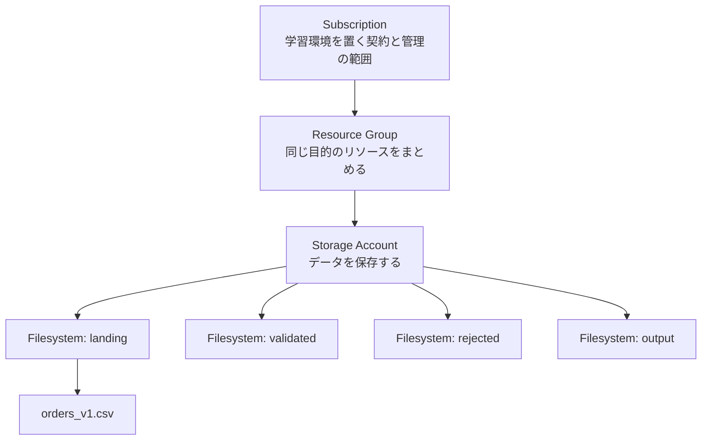
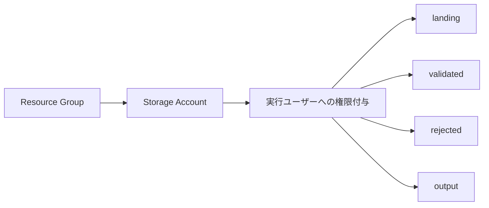

# Phase 1: CSVの保存先をTerraformで作る

Phase 1で確かめたのは、手元の`orders_v1.csv`をAzureへ置き、ダウンロードし直すと元の内容と一致する、という短い往復です。この往復のために書いたTerraformには、保存先そのものの設定に加えて、名前の受け渡し、作成の順序、アクセス権限の指定が含まれています。

この解説は、プログラムの変数やファイルの読み書きには慣れていて、TerraformとAzureはこれから学ぶ読者を想定しています。実際のコードを小さく抜き出しながら、CSVを置けるようになるまでのつながりを追います。掲載したコマンドは意味を説明するためのもので、実際に操作するときの順序と承認条件は[学習計画のPhase 1](../learning-plan.md#phase-1-storage)を正とします。シェルの記号で立ち止まったときは、末尾の[補足](#補足シェルの記法と検証用のファイル)を参照してください。

## 1. CSVを置く場所

手元のサンプルは、注文情報を並べたCSVです。[元のファイル](../../samples/valid/orders_v1.csv)の先頭には、次の内容が入っています。

```csv
order_id,customer_id,amount,currency,ordered_at
10001,C001,12800,JPY,2026-08-27T10:30:00
```

このファイルをAzureのどこに置くのかを、管理上のまとまりも含めて描くと次のようになります。



| 用語 | 役割 |
|---|---|
| Subscription | 課金とアクセス権限を管理する範囲。学習用に`Personal-Sandbox`を使う |
| Resource Group | 同じ目的で管理するリソースのまとまり。学習用のStorageを1つのResource Groupに入れる |
| Storage Account | データを保存するリソース。アクセス方法や、どの地域で保持するかを設定する |
| Filesystem | Storage Accountの中の保存領域。中にディレクトリやファイルを置ける |

Filesystemは、Azure Blob Storageのコンテナーにあたります。Portalでは「コンテナー」と表示されることもあるので、両方の呼び方を知っておくと同じ保存先を見つけられます（[ADLSの説明](https://learn.microsoft.com/azure/storage/blobs/data-lake-storage-introduction)）。

CSVを直接置くのは`landing`です。残りの3つは、後のPhaseでCSVを検証して振り分けるための保存先で、Phase 1では作るだけです。各領域の役割は[アーキテクチャのストレージ領域](../architecture.md#ストレージ領域)にあります。

## 2. resourceブロックの読み方

Terraformでは、作りたいリソースの状態をHCLという言語で書きます。Resource Groupの名前と配置先だけを書くと、次のようになります。これは[実際の`main.tf`](../../infra/terraform/main.tf)から必要な部分を抜き出し、入力値を具体的な文字列に置き換えた説明用の例です。

```hcl
resource "azurerm_resource_group" "lab" {
  name     = "rg-example"
  location = "japaneast"
}
```

波括弧で囲まれたひとまとまりを、resourceブロックと呼びます。この例は、「名前が`rg-example`で、配置先が`japaneast`のResource Groupがある」という希望する状態を表しています。

先頭の行と`name`には、別々の名前が出てきます。それぞれが何を指すのかを分けて読むと、コードの形が見えてきます。

| 記述 | 意味 |
|---|---|
| `azurerm_resource_group` | リソースの種類。AzureのResource Groupを表す |
| `lab` | Terraformのコードの中で、このリソースを指すための名前 |
| `name = "rg-example"` | Azure上に作るResource Groupの名前 |

Terraformの中では、種類と名前をつないだ`azurerm_resource_group.lab`がこのリソースの識別子になります。種類が違えば同じ`lab`という名前を付けられるので、Storage Accountは`azurerm_storage_account.lab`として別のリソースになります（[resourceブロックの構文](https://developer.hashicorp.com/terraform/language/resources/syntax)）。

`.tf`ファイルにこのブロックを書いただけでは、Azure上にResource Groupはできません。実際に作るのは、8節で扱う`apply`です。

## 3. 環境ごとの名前を変数にする

実際のコードでは、Resource Groupの名前を直接書かず、入力変数から受け取っています。

```hcl
resource "azurerm_resource_group" "lab" {
  name     = var.resource_group_name
  location = var.location
  tags     = var.tags

  # この抜粋では、接続先を確認する条件を省略している。
}
```

`var.resource_group_name`は、`resource_group_name`という入力変数の値を参照する書き方です。入力変数は[`variables.tf`](../../infra/terraform/variables.tf)で次のように宣言しています。

```hcl
variable "resource_group_name" {
  description = "この学習環境で新規作成するResource Group名。"
  type        = string
  nullable    = false
}
```

`type = string`は文字列を受け取るという指定、`nullable = false`は`null`を受け付けないという指定です。既定値もないので、使う側が必ず名前を渡す必要があります。`description`には、その入力の用途を書きます。

値は`terraform.tfvars`というファイルにまとめて書きます。このファイルに次の行があれば、その値がResource Groupの`name`に使われます。

```hcl
resource_group_name = "rg-example"
```

```text
terraform.tfvarsの resource_group_name
              ↓
      var.resource_group_name
              ↓
    Resource Groupの name
```

こうしておくと、名前を変えたいときは入力だけを書き換えればよく、Storageの種類や接続関係を定義したコードはそのまま使えます。同じように、`var.location`は配置先を、`var.tags`は管理用の名札（キーと値の組）を渡します。タグを変えても、ファイルの保存場所は変わりません。

`variable`と`resource`は別々のファイルに書かれていますが、Terraformは同じディレクトリにある`.tf`をすべてまとめて読みます。`variables.tf`や`main.tf`というファイル名は、内容を見つけやすくするための整理にすぎません。

## 4. StorageをResource Groupにつなぐ

Storage Accountを作るには、どのResource Groupに所属させるかを指定する必要があります。[`storage.tf`](../../infra/terraform/storage.tf)では、その部分を次のように書いています。

```hcl
resource "azurerm_storage_account" "lab" {
  name                = var.storage_account_name
  resource_group_name = azurerm_resource_group.lab.name
  location            = azurerm_resource_group.lab.location

  # この抜粋では、Storage固有の設定を省略している。
}
```

`resource_group_name`の右側は、3つの部分に分けて読めます。

```text
azurerm_resource_group . lab . name
     リソースの種類      識別名   そのリソースの名前の値
```

つまり「2節で定義したResource Groupの名前を使う」という意味です。同じ文字列を2か所に書かずに参照でつなぐので、Resource Groupの名前を変えれば、所属先の指定も自動で追従します。

Terraformは、この参照から作成の順序も読み取ります。StorageはResource Groupがなければ作れないので、Resource Groupを先に作ります。実際のapplyでも、Resource Groupの作成が終わってからStorageの作成が始まりました。

### ADLS Gen2を有効にする設定

Storage Accountには、ファイルをどのような構造で保存するかを選ぶ設定もあります。データ分析向けにディレクトリを扱えるようにしているのが、次の行です。

```hcl
is_hns_enabled = true
```

HNS（Hierarchical Namespace）は、ディレクトリの階層を扱うための機能です。HNSを有効にしたBlob Storageでは、ADLS Gen2（Azure Data Lake Storage Gen2）の機能を使えます。Storage Accountを土台にして、データ分析向けの保存機能を上に載せる構成です（[ADLSの概要](https://learn.microsoft.com/azure/storage/blobs/data-lake-storage-introduction)）。

性能と複製の方式は、別の設定で指定しています。

```hcl
account_tier             = "Standard"
account_replication_type = "LRS"
access_tier              = "Hot"
```

`Standard`は標準の性能区分、`Hot`は頻繁にアクセスするデータ向けのアクセス層で、小さなCSVを置いてすぐに読み返す今回の用途に合わせています。`LRS`は、1つのデータセンターの中で複製を持つ方式です。別の拠点にも複製を持つ方式に比べると、障害への備えは小さくなります（[Azure Storageの冗長化](https://learn.microsoft.com/azure/storage/common/storage-redundancy)）。これらの選択は、[学習環境の制約](../project-brief.md#学習環境の制約)に沿っています。

## 5. TerraformからAzureへ接続する

ここまでのコードを、Azureへの操作に変換するのはAzureRM Providerです。ProviderはTerraformに機能を追加するプラグインで、AzureRM ProviderはAzureのAPIを呼び出す役割を持ちます。

```text
手元の.tfファイル
       ↓
Terraformが構成と依存関係を読む
       ↓
AzureRM ProviderがAzureのAPIを呼ぶ
       ↓
Azure側でリソースが作られる
```

APIは、プログラムからAzureへ操作を依頼する窓口です。使うProviderは[`versions.tf`](../../infra/terraform/versions.tf)の`required_providers`で指定し、8節の`terraform init`が取得します。

### 誰が、どこを操作するか

Azureへのログインには、Azure CLIを使います。ログインした人の本人確認はMicrosoft Entra IDが行い、AzureRM Providerは、このログイン済みユーザーとしてAzureにアクセスします。

どのSubscriptionを操作するかは、[`providers.tf`](../../infra/terraform/providers.tf)で指定します。

```hcl
provider "azurerm" {
  features {}

  subscription_id = var.subscription_id

  # この抜粋では、Provider登録とデータ認証の設定を省略している。
}
```

`features {}`はAzureRM Providerの動作設定を置くブロックで、今回は追加の設定を入れていません。ログインが「誰が操作するか」を決め、`subscription_id`が「どこを操作するか」を決めます。

Subscription IDは、ファイルではなく環境変数から渡します。

```bash
export TF_VAR_subscription_id="$ARM_SUBSCRIPTION_ID"
```

Terraformは、`TF_VAR_`で始まる環境変数を入力変数の値として読みます。`TF_VAR_subscription_id`の`subscription_id`の部分が、HCLの`variable "subscription_id"`に対応し、コードからは`var.subscription_id`として参照できます。

### 接続先が正しいかを確かめる

IDを渡しただけでは、そのIDが本当に学習用のSubscriptionを指しているかはわかりません。そこで、Azureにすでにある情報を読み取るdataブロックを使って確かめます。

```hcl
data "azurerm_subscription" "current" {
  subscription_id = var.subscription_id
}
```

`resource`と違い、`data`は何も作りません。渡されたIDのSubscriptionの情報を読み取るだけです。読み取った名前は`data.azurerm_subscription.current.display_name`で参照でき、`main.tf`の`precondition`（実行前に満たすべき条件）でこの名前を照合します。学習用の接続先と一致しなければ、planはその場で失敗します。学習用のSubscriptionを分けた理由は[ADR-0001](../adr/0001-isolate-learning-subscription.md)にあります。

### Azure側のResource Provider

前準備では、`Microsoft.Storage`というResource Providerを登録しました。名前は似ていますが、これはAzure側の仕組みで、手元で使うAzureRM Providerとは役割が違います。

| 呼び方 | 今回の名前 | どこで何をするか |
|---|---|---|
| Terraform Provider | `hashicorp/azurerm` | Terraformを実行する環境で、Azure向けの操作を処理する |
| Azure Resource Provider | `Microsoft.Storage` | Azure側で、Storageのリソースを扱うAPIを提供する |

`Microsoft.Storage`の登録は、対象のSubscriptionでStorageのAPIを使えるようにする準備で、登録しただけではStorage Accountはできません（[Resource Providerの説明](https://learn.microsoft.com/azure/azure-resource-manager/management/resource-providers-and-types)）。今回のコードは、AzureRM ProviderがResource Providerを自動で登録する機能を無効にしています。登録というAzure側への変更を、承認を受ける前準備として分けておくためです。

## 6. Storageを作る権限と、CSVを読み書きする権限

Storage Accountを作れたからといって、同じユーザーがCSVを書き込めるとは限りません。Azureでは、リソースの設定を管理する操作と、中に保存したデータを扱う操作に、別々の権限が必要です。

今回の実行ユーザーは、管理用の`Owner`ロールを持っていました。このロールでStorageの作成や権限の付与はできますが、Entra認証でデータにアクセスする権限は含まれていません（[データアクセス権限の説明](https://learn.microsoft.com/azure/storage/blobs/assign-azure-role-data-access)）。そこで[`storage.tf`](../../infra/terraform/storage.tf)は、Storage本体に加えて、データ用の権限も定義しています。

```hcl
resource "azurerm_role_assignment" "operator_blob_data" {
  scope                = azurerm_storage_account.lab.id
  role_definition_name = "Storage Blob Data Contributor"
  principal_id         = data.azurerm_client_config.current.object_id
  principal_type       = "User"
}
```

このRole Assignmentは、権限の割り当てそのものを1つのリソースとして管理します。3つの指定は「誰に、何を、どこまで許可するか」と読めます。

| 指定 | 読み方 |
|---|---|
| `principal_id` | 誰に。Terraformを実行したユーザー |
| `role_definition_name` | 何を。Filesystemの作成やデータの読み書きを許可するロール |
| `scope` | どこまで。新しく作るStorage Accountだけ |

`data.azurerm_client_config.current.object_id`は、いまの接続で認証されたユーザーのIDです。5節のSubscription情報と同じく、`data`で読み取った値を参照しています。`scope`には作成するStorage Accountへの参照を指定しているので、実行ユーザーがデータを扱える範囲はこのStorageに限られます。後のPhaseでAzure上のプログラムに権限を与えるときも、同じ3つの観点で読めます。

### 権限を使う認証方法もそろえる

権限を与えたら、その権限を使う認証方法でStorageへアクセスする必要があります。[`providers.tf`](../../infra/terraform/providers.tf)の次の設定は、TerraformがStorageのデータを操作するときにEntra認証を使うという指定です。プロパティ名に`azuread`と旧名が残っていますが、指しているのはMicrosoft Entra IDです。

```hcl
storage_use_azuread = true
```

Azure CLIでCSVを読み書きするときは、`--auth-mode login`で同じ指定をします。Storage Account側では`shared_access_key_enabled = false`によって、アカウントキーを使う認証を無効にしています。「ユーザーに権限を与える設定」と「そのユーザーとして認証する設定」がそろって、はじめてデータにアクセスできます。

## 7. 4つのFilesystemと作成の順序

Storage Accountと権限がそろえば、その中に`landing`などの保存領域を作れます。[`storage.tf`](../../infra/terraform/storage.tf)は、4つの名前を1つのブロックに渡しています。

```hcl
resource "azurerm_storage_data_lake_gen2_filesystem" "zones" {
  for_each = toset(["landing", "validated", "rejected", "output"])

  name               = each.value
  storage_account_id = azurerm_storage_account.lab.id

  depends_on = [azurerm_role_assignment.operator_blob_data]
}
```

`for_each`は、渡した値ごとにリソースを1つずつ定義する指定です。`toset(...)`で4つの文字列を集合（重複と順序を持たないまとまり）に変換しているので、それぞれの名前がFilesystemを見分けるキーになります（[for_eachの説明](https://developer.hashicorp.com/terraform/language/meta-arguments/for_each)）。`each.value`には名前が1つずつ入り、たとえば`landing`のときは`name = "landing"`のFilesystemが定義されます。Terraformはこれを次の識別子で管理します。

```text
azurerm_storage_data_lake_gen2_filesystem.zones["landing"]
```

1つのブロックから4つのリソースができるので、`resource`ブロックの数を数えても、作られるリソースの数とは一致しません。

### 権限への依存を明示する理由

このブロックには、2種類の依存が書かれています。1つは`storage_account_id`による参照で、TerraformはこれによってStorageの作成が終わるのを待ちます。

しかし、Storageがあっても、データ用の権限がなければFilesystemは作れません。Filesystemのコードは権限の値を参照していないので、Terraformはこの関係を自動では読み取れません。そこで、`depends_on`で権限の付与を待つように明示しています。その結果、作成の順序は次のようになります。



4つのFilesystemは互いを待たないので、権限の付与が終わると同時に並行して作成が始まります。実行の順序を決めているのは、コード上の並び順ではなく、この依存関係です。

ただし、`depends_on`が待つのは、Terraformから見て権限の付与処理が終わるところまでです。Azureでは、権限を割り当ててから実際のアクセスに反映されるまでに時間差が出ることがあります。反映を待つ必要が出た場合の対処は、[適用手順](../learning-plan.md#5-承認されたplanを適用する)にあります。

## 8. init、plan、apply、state

宣言がそろったら、コードをAzure上の構成にします。この操作は、準備（init）、差分の確認（plan）、適用（apply）の3段階に分かれています。

### initで準備する

`init`は、このディレクトリでTerraformを使うための準備です。Providerの取得と、stateの保存先の初期化を行います。このリポジトリでは、保存済みのstateを確認してからTerraformの初期化を実行するスクリプトを使います。

```bash
node scripts/terraform/backend.mjs init
```

`init`だけでは、Azureには何も作られません。

### planで作成予定を確かめる

planは、コードと実際のAzureを照合し、何を作り、何を変え、何を消す必要があるかを計算する操作です。次のコマンドは、計算したplanを`phase1.tfplan`というファイルに保存します。保存しておけば、確認したplanをそのまま適用できます。`-chdir=infra/terraform`は、Terraformが構成を読むディレクトリの指定です。

```bash
terraform -chdir=infra/terraform plan -out=phase1.tfplan
```

Phase 1の初回構築では、planに次の作成予定が含まれていました。種類と個数をコードと見比べると、対応が追えます。

| 作成するもの | 個数 |
|---|---:|
| Resource Group | 1 |
| Storage Account | 1 |
| 実行ユーザーへのRole Assignment | 1 |
| Filesystem | 4 |
| 合計 | 7 |

planの末尾には、この合計が表示されました。

```text
Plan: 7 to add, 0 to change, 0 to destroy.
```

`add`は追加、`change`は既存リソースの変更、`destroy`は削除の件数です。個々のリソースの行では、先頭の`+`が作成を表します。

planには`(known after apply)`という表示も出てきます。これは、作成してみないと決まらない値です。どのリソースを参照するかはコードからわかっても、そのリソースに割り当てられるIDのような値までは、planの時点ではわかりません。

planを読むときは、個数に加えて、接続先のSubscriptionと、Storageや権限がどのリソースを参照しているかも照合します。planを作れたことと、その変更を実施してよいと判断することは、別の段階です。

### applyで保存したplanを実行する

applyは、planにある変更をAzureへ反映する操作です。承認を受けた後、保存したplanを指定して実行しました。

```bash
terraform -chdir=infra/terraform apply phase1.tfplan
```

Terraformは、7節の依存関係に沿ってAzureへ作成を依頼し、次の結果で終わりました。

```text
Apply complete! Resources: 7 added, 0 changed, 0 destroyed.
```

### stateでコードと実物を対応づける

作成した後も、Terraformは「コード上の`azurerm_storage_account.lab`が、Azure上のどのStorageなのか」を覚えておく必要があります。この対応と、リソースの属性を記録しておくのがstateです（[stateの説明](https://developer.hashicorp.com/terraform/language/state)）。

```text
コード上の識別子
azurerm_storage_account.lab
          ↕ stateが対応を記録
Azure上に作成されたStorage Account
```

次にplanを実行するとき、Terraformはこの対応を使ってAzure上の実物を読み取り、コードとの差分を計算します。stateだけを見て、実物を確かめずに一致と判断するわけではありません。

stateの保存場所を決めるのがbackendです。Phase 1の初回構築ではローカルに保存しましたが、CIと共有するためにAzure上のStorageへ移しました。現在の保存先と移行・復旧の手順は[stateの共有と移行](../terraform-state.md)にあります。stateには識別子や機密情報が含まれることがあるので、Gitで管理せず、扱い方は[ローカル入力の手順](../learning-plan.md#2-ローカルの入力を用意する)に従います。

## 9. CSVを往復させて確かめる

applyが成功したら、作った保存先へ実際にCSVを読み書きできるかを確かめます。リソースの作成が成功していても、権限が反映されていなかったり、別のパスを指定していたりすれば、CSVは置けないためです。

アップロードに使ったAzure CLIの指定は、手元とAzureに分けて読めます。

| 指定 | 意味 |
|---|---|
| `--source samples/valid/orders_v1.csv` | 手元で読み取るファイル |
| `--account-name` | Azure側のStorage Account |
| `--file-system landing` | そのStorageの中のFilesystem |
| `--path orders_v1.csv` | Filesystemの中の保存先のパス |
| `--auth-mode login` | ログイン済みユーザーのEntra認証を使う |

```text
手元: samples/valid/orders_v1.csv
                  ↓ アップロード
Azure: Storage Account / landing / orders_v1.csv
```

Storage Accountの名前は、Terraformのoutputから取り出しました。outputは、Terraformが管理している値を、後の操作で取り出せるようにする宣言です。[`outputs.tf`](../../infra/terraform/outputs.tf)では、Storageの名前を返すように定義しています。

```hcl
output "storage_account_name" {
  description = "CSV配置先のStorage Account名。"
  value       = azurerm_storage_account.lab.name
}
```

```bash
terraform -chdir=infra/terraform output -raw storage_account_name
```

`-raw`は、値を引用符などで囲まずに、そのままの文字列で出力する指定です。こうして得た名前をAzure CLIに渡します。

アップロードした後は、同じファイルを一時ファイルへダウンロードし、`cmp`（ファイルをバイト単位で比べるコマンド）で元のファイルと比べました。終了コードは0で、内容は一致しました。

さらに、CSVを置いた状態でもう一度planを実行すると、次の結果になりました。

```text
No changes. Your infrastructure matches the configuration.
```

ファイルを1つ追加したのに差分が出ないのは、Terraformの管理対象にCSVを含めていないためです。StorageとFilesystemは`resource`で定義していますが、`orders_v1.csv`の中身はどこにも定義していません。この`No changes`は、「管理している基盤の構成は変更不要」という意味です。

これで、冒頭のCSVを保存し、同じ内容で取り出せるところまでつながりました。Phase 2では、この`landing/orders_v1.csv`を読み、列や値を検証する処理を加えます。

## 理解度チェック

1. `azurerm_resource_group.lab`の`lab`と、`name = "rg-example"`の`rg-example`は、それぞれ何を指すか。（2節）
2. Storageの`resource_group_name`に文字列を直接書かず、Resource Groupを参照するのはなぜか。（4節）
3. `subscription_id`を渡すだけでなく、dataブロックでSubscriptionの名前を照合するのはなぜか。（5節）
4. `Owner`ロールを持つユーザーに、さらに`Storage Blob Data Contributor`を付けるのはなぜか。（6節）
5. Filesystemに`depends_on`が必要なのはなぜか。（7節）
6. CSVを置いた後のplanが`No changes`になるのはなぜか。（9節）

答えを書いたら、該当する節と実際の`.tf`ファイルを読み直し、説明とコードが一致しているかを確かめます。

## 補足：シェルの記法と検証用のファイル

実行手順には、Terraformの構文ではないシェルの記法も出てきます。手順中のコマンドで立ち止まったときに参照してください。

### 環境変数を渡す記法

```bash
export ARM_SUBSCRIPTION_ID="$(az account show --subscription Personal-Sandbox --query id -o tsv)"
export TF_VAR_subscription_id="${ARM_SUBSCRIPTION_ID:?Subscription IDを取得できていません}"
```

1行目は、Azure CLIで取得したSubscription IDを環境変数に入れています。`$(...)`は中のコマンドを実行してその出力を使う記法で、`--query id`でIDだけを取り出し、`-o tsv`で引用符のないテキストとして出力します。`export`を付けると、後から起動するTerraformにもその変数が渡ります。

2行目の`${変数:?メッセージ}`は、変数が未設定か空のときに、メッセージを表示してエラーにする記法です。IDを取得できなかったまま、空の値を渡して先へ進むことを防ぎます。

### ファイル操作や長いコマンドの記法

| 記法 | 手順の中での用途 |
|---|---|
| 行末の`\` | 長いコマンドを次の行へ続ける |
| `>` | コマンドの出力をファイルへ書き出す。同名のファイルがあれば上書きする |
| `umask 077` | この後に作るファイルを、他のユーザーが読み書きできないようにする |
| `mktemp` | 名前が衝突しない一時ファイルを作り、そのパスを返す |
| `cp -n` | コピー先が既にある場合は上書きしない |

どれも、実行用の入力や比較用のファイルを準備するためにシェルで使っているもので、構成の値を変えるものではありません。

### planのJSONとjq

保存したplanは、プログラムで扱えるJSONとして取り出せます。

```bash
terraform -chdir=infra/terraform show -json phase1.tfplan
```

手順の中の`jq`は、このJSONから必要な項目だけを取り出すコマンドです。取り出しているのは、接続先の照合結果と、各リソースを追加するか変更するかといった操作の一覧です。Terraform 1.16で確かめたplanでは、読み取ったSubscriptionの情報が`prior_state`に入っていたため、その箇所を参照しています。JSON全体の構造を覚える必要はなく、照合結果と操作の一覧の意味がわかれば、planを確認する目的は追えます。

### ProviderのロックとCI

`.terraform.lock.hcl`は、Providerを同じバージョンで再現するためのファイルです。選んだバージョンと、取得したパッケージを確かめるためのチェックサムが記録されます。Azure上のリソースとの対応を記録するstateとは、役割が違います。

手元のMacとGitHub ActionsのLinuxでは、Providerのパッケージが異なります。そのため、ロックファイルには両方の環境のチェックサムを記録しています。

GitHub Actionsで自動実行する検証を、CI（継続的インテグレーション）と呼びます。このリポジトリのCIは、書式と構成を確かめ、Azure APIをモック（実際の呼び出しを、用意した応答に置き換えること）にしたテストで、Subscriptionの取り違えを拒否できるかを確かめます。実際のAzureで権限が通るか、CSVを読み書きできるかは、9節の実環境での確認が受け持っています。
